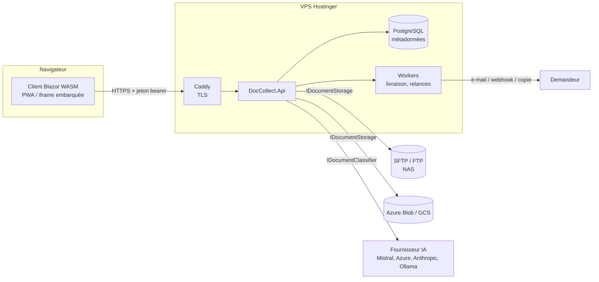
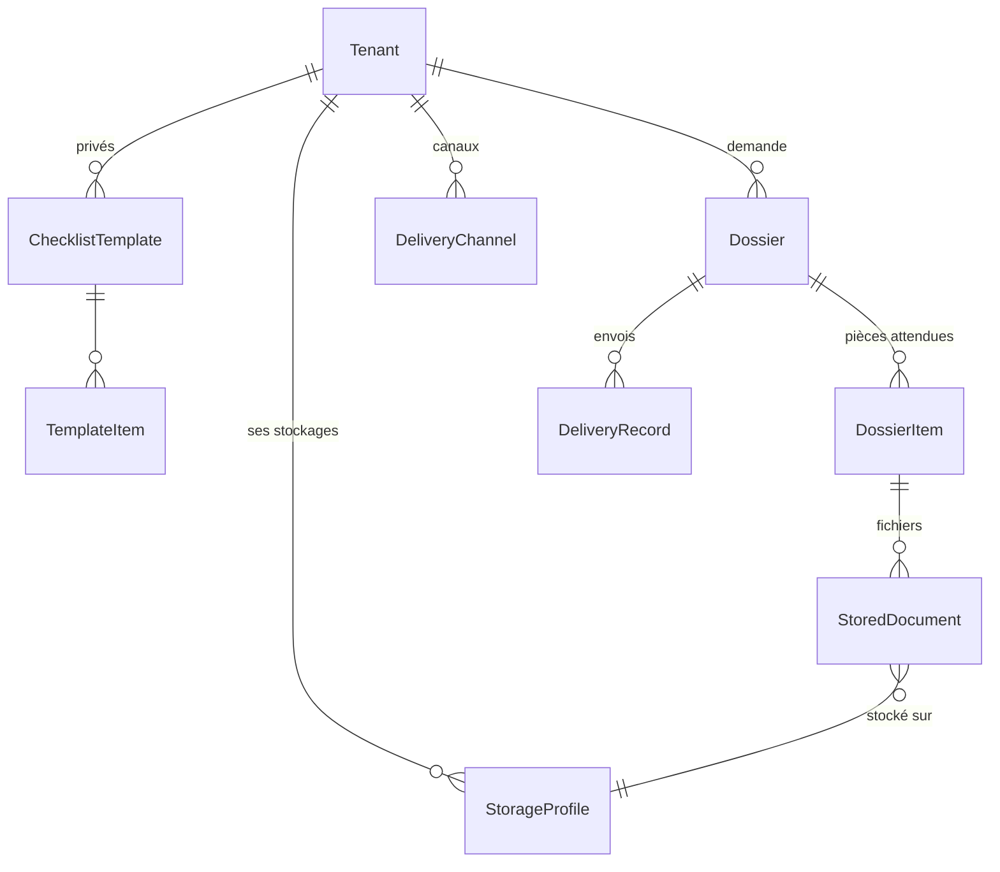
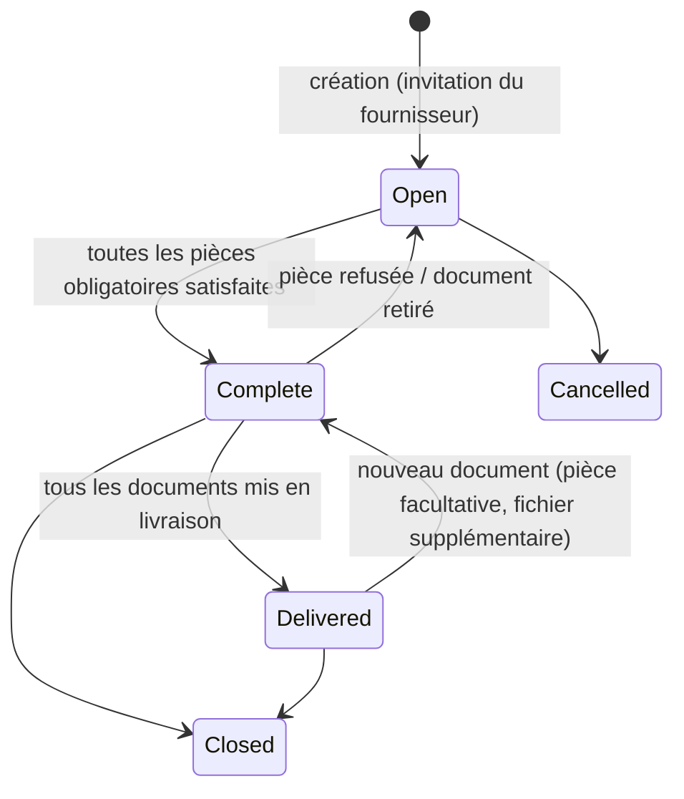

# Architecture

## Vue d'ensemble

L'API héberge aussi les fichiers du client Blazor : une seule image Docker, une seule origine (pas de CORS, pas de cookie tiers en iframe).

## Couches

| Projet | Rôle | Dépendances |
|---|---|---|
| `Shared` | DTO et énumérations échangés avec le client (énumérations sérialisées en texte) | — |
| `Domain` | Entités et règles : complétude, validation, ce qui est prêt à livrer | Shared |
| `Core` | Abstractions et services techniques sans dépendance externe : `IDocumentStorage`, `DocumentEncryptor`, `SecretProtector`, `IDocumentClassifier`, `DocumentIngestionService`, gestionnaires de livraison, modèles d'e-mails | Domain |
| `Infrastructure` | EF Core/PostgreSQL, fournisseurs FTP/SFTP/Azure/GCS, SMTP (MailKit), `DeliveryScheduler`, `DeliveryWorker`, `ReminderWorker` | Core + NuGet |
| `Api` | Endpoints (auth, admin, demandeur, fournisseur), politique 2FA, CSP d'intégration, initialisation | Infrastructure, Client |
| `Client` | Interface Blazor WebAssembly | Shared |

Le cœur (`Domain` + `Core`) n'utilise que la BCL .NET : il se teste sans base ni réseau.

## Modèle de données

- Un modèle public a `TenantId = null` et `Visibility = Public`.
- Les pièces d'un dossier sont **copiées** du modèle à la création : modifier un modèle n'altère pas les dossiers en cours.
- `StoredDocument` ne contient que des métadonnées : nom d'origine, type réel, taille, SHA-256, clé de stockage (`{tenant}/{année}/{dossier}/{document}.bin`, le nom d'origine n'apparaît jamais sur le stockage), clé de données scellée, verdict IA.

## Cycle de vie d'un dossier

Une pièce est **satisfaite** si elle a au moins un document et, quand le dossier exige la validation du demandeur, si elle est acceptée.

`Dossier.DocumentsReadyForDelivery()` :
- mode **Incremental** : documents des pièces satisfaites non encore livrés ;
- mode **AllAtOnce** : rien tant que le dossier n'est pas complet, puis tous les documents non livrés.

## Chaîne de dépôt (`DocumentIngestionService`)

1. Copie dans un fichier temporaire avec calcul du SHA-256 et coupure au-delà de la taille maximale de la pièce.
2. Détection du **type réel** par les premiers octets (`ContentSniffer`) ; les exécutables sont refusés.
3. Contrôles métier (type accepté, taille, nombre de fichiers, dossier ouvert).
4. Vérification IA si le demandeur l'a activée et si la pièce indique un type attendu (le verdict n'est jamais bloquant).
5. Chiffrement (si activé) puis écriture dans le stockage du demandeur (ou celui de la plateforme).
6. Rattachement au dossier ; en cas d'échec, l'objet écrit est supprimé.
7. `DeliveryScheduler` crée un `DeliveryRecord` par canal actif ; `DeliveryWorker` les exécute avec reprise (1 min, 5 min, 30 min, 2 h, 12 h).

## Authentification

- ASP.NET Identity, jetons « bearer » (pas de cookie) : fonctionne en iframe et sur mobile.
- Politique par défaut : utilisateur connecté **et** claim `dc:2fa=true`. Sans 2FA, seul l'enrôlement est accessible.
- Détails : [security.md](security.md).
